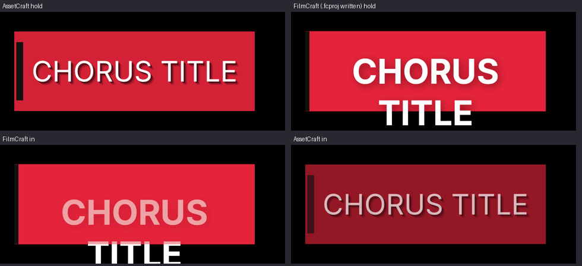
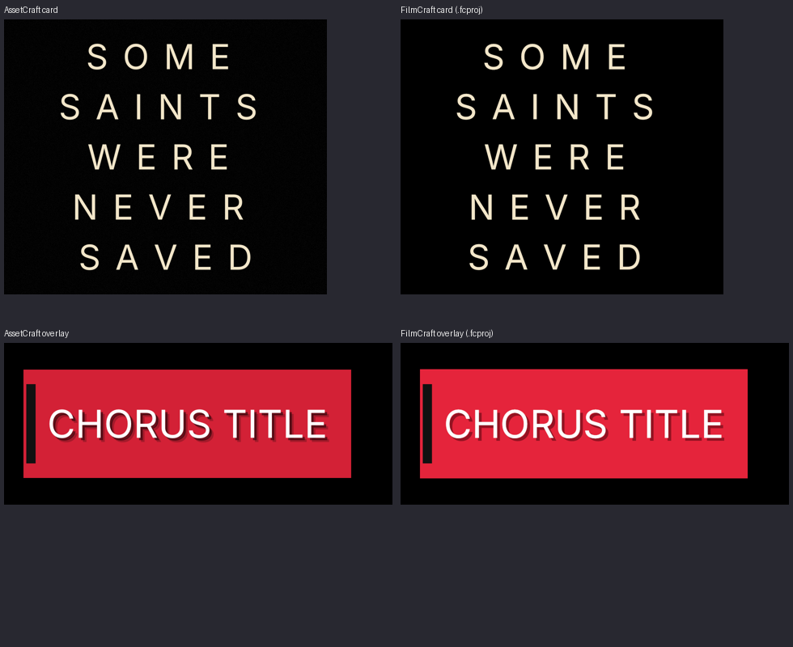
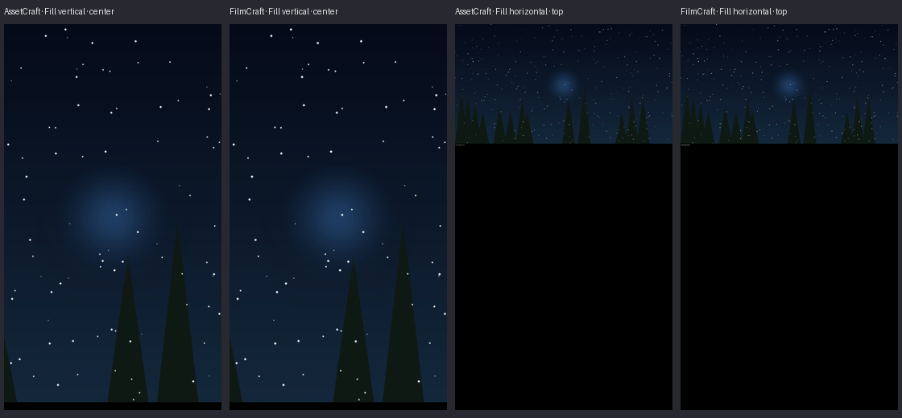

# FilmCraft graphic clips: can an AssetCraft title arrive editable?

_2026-11-27 · D-SF8 FC-1 / FC-2, GC-12, SF1b-3 · built; in-app titles reach FilmCraft as they draw, shots as they're framed_

- **Scope:** whether an AssetCraft in-app title (a theme's words on a plate, in an area, with
  its in) can be handed to FilmCraft as a native graphic clip instead of a rendered `.mp4`.
- **Project goal it serves:** Send to FilmCraft without baking titles to video files (Paul,
  2026-11-25: rendered `.mp4`s waste disk and make moving a project harder; FilmCraft's and
  EffectCraft's effect controls aren't shared).
- **Immediate area of improvement:** the rest of a card's background (GC-11); Paul's check of
  File › Send to FilmCraft on his PC (T-S8 … T-S11 in the test checklist).

## How it was checked

[`spikes/filmcraft_graphic_clip_spike.rs`](spikes/filmcraft_graphic_clip_spike.rs) ran as a
throwaway test in a local clone of storytold/filmcraft `960a661` (nothing added upstream). Using
only FilmCraft's own commands, it did these steps:

- made a 1080 × 1920, 24 fps sequence;
- built one graphic clip with a rectangle plate (the AssetCraft area, 810 × 268.8 at the safe
  area's middle) and a bold, centred paragraph text layer;
- keyed the words' opacity and position for a 0.5 s rise-in;
- saved the project as `.fcproj` and opened it in a fresh session;
- listed the layers and exported frames;
- changed the words.

## Spike 2: AssetCraft writes the `.fcproj` (2026-11-27)

[`spikes/filmcraft_fcproj_writer_spike.rs`](spikes/filmcraft_fcproj_writer_spike.rs) built AssetCraft's
Bold overlay on a 1080 × 1920 board as plate, accent bar and words. It keyed the words' in and
wrote the project with `filmcraft_format::encode`. FilmCraft's engine then opened the file and
exported its frames.

## FC-1 / FC-2: `storyboard.writeFcproj` (2026-11-27)

The compositor hands back each in-app title as it draws it (FC-1, `crates/animatic/src/layout.rs`
`Compositor::title_layout`). That covers the face and its em size, the tracking, every line and
where it sits, the plate, the decor and the finish. Drawn back from those numbers alone, it
matches the compositor's own frame (test `a_titles_layout_draws_back_to_its_frame`).

FC-2 (`crates/engine/src/fcproj_out.rs`) builds the project in four steps:

1. Writes the Cut as OTIO with in-app titles left out.
2. Reads it with FilmCraft's own importer to get the shots, the song and the scene markers.
3. Adds each in-app title as a graphic clip built from that layout: a card on V1, an overlay on V2
   over its shot. Its in and out are opacity, position and scale keys sampled from the clip's own
   timing.
4. Writes the project with `filmcraft_format::encode`.

A title drawn by a design goes as its render. Frames exported by FilmCraft's engine from the
written file, at 1080 × 1920:

| Title                                   | Mean difference per channel | Pixels off by > 64 | Lines                     |
|-----------------------------------------|-----------------------------|--------------------|---------------------------|
| Bold overlay "Chorus title" (held)      | 1.1                         | 0.5 %              | same rows                 |
| Cinematic card, five lines (at 1.0 s)   | 4.4                         | 1.0 %              | same rows (±1 px)         |

The card's remaining difference is its backdrop's grain and vignette (GC-11).

### GC-12: shots framed as the board frames them (2026-11-27)

FilmCraft fits each shot whole to the frame (`scale_to_frame`, factor `min(fw/pw, fh/ph)`) and then
applies the clip's Motion. So `fcproj_out.rs` sets Motion scale to `cover / fit × 100` and Motion
position to the centre `FrameSpec::place` gives, for every picture shot (an overlay's shot under
its graphic clip included; a render stays fitted, since it is already the frame). Exported by
FilmCraft's engine at 1080 × 1920 from a landscape still:

| Shot framing                  | Mean difference per channel | Pixels off by > 64 |
|-------------------------------|-----------------------------|--------------------|
| Fill vertical · center        | 0.1                         | 0 %                |
| Fill horizontal · top         | 0.03                        | 0 %                |

## SF1b-3: File › Send to FilmCraft (2026-11-27)

`storyboard.sendToFilmCraft {open?}` (`fcproj_out.rs`), in the File menu right after Export
Video…:

1. A title problem (design, theme, media, effect, font) stops it, listed, before anything is
   written.
2. Titles a design draws that aren't rendered yet render first on the export thread
   (`storyboard.renderTitles {designed: true}`: an in-app title never renders, it goes as a
   graphic clip). The answer is `{stage: "rendering"}`, and the app sends again by itself when
   `storyboard.exportStatus` says done; a cancelled or failed render drops the send.
3. `storyboard.writeFcproj` writes `<name>.fcproj` beside the storyboard (`stage: "written"`).
4. `file.openIn {app: "filmcraft"}` opens it (`stage: "opened"`). When FilmCraft isn't installed
   the project stays written and the message says where it is.

## Findings

| ID    | Finding                                                                                                                                                                                                                                                                                                       | Evidence                                                                                     | Fix / next step                                                                                                                                                                                               | Owner           | Status                                         |
|-------|---------------------------------------------------------------------------------------------------------------------------------------------------------------------------------------------------------------------------------------------------------------------------------------------------------------|----------------------------------------------------------------------------------------------|---------------------------------------------------------------------------------------------------------------------------------------------------------------------------------------------------------------|-----------------|------------------------------------------------|
| GC-1  | **It works.** A graphic clip with a plate and words, keyframed, survives save → open (`schemaVersion` 17, 7.7 KB project, no media files) and is editable after (`graphics.setText`)                                                                                                                          | the spike's log and frames above; `crates/project/src/graphic.rs:1-12`                       | Use FilmCraft graphic clips for in-app titles (option B)                                                                                                                                                      | —               | confirmed                                      |
| GC-2  | **The mapping needs care:** a text layer's position is its box's top-left (`localBounds [0,0,730,116]`), so the words sat off the plate; the spike also guessed the theme's colours (AssetCraft's Bold: red plate, caps, accent bar, shadow)                                                                  | frames 3–5 above                                                                             | Build the layers from AssetCraft's own layout of the title (GC-7 to GC-10), not from the theme alone                                                                                                          | Claude          | fixed by FC-1 / FC-2                           |
| GC-3  | **OTIO can't carry graphic clips**, so this route needs FilmCraft's project file or its commands                                                                                                                                                                                                              | `crates/interchange/src/lib.rs:593`                                                          | —                                                                                                                                                                                                             | —               | confirmed                                      |
| GC-4  | **Two hand-off routes:** write the `.fcproj` with `filmcraft-project` / `filmcraft-format` (offline, no FilmCraft running), or drive FilmCraft's commands (`graphics.newShape`, `graphics.newText`, `graphics.set`, `file.saveAs`) as the spike did (the suite's command rule; needs FilmCraft or its engine) | the spike                                                                                    | **Decided 2026-11-27 (Paul): write the `.fcproj`.** Spike 2 below                                                                                                                                             | Paul            | decided                                        |
| GC-5  | **Build cost:** `filmcraft-engine` took 12 min and ~720 MB of target to build here                                                                                                                                                                                                                            | the spike                                                                                    | Prefer the `.fcproj` writer (project crates only) if AssetCraft links FilmCraft code                                                                                                                          | Claude          | noted                                          |
| GC-6  | **EffectCraft designs** (Stack, Laser Trace, pack designs) have no FilmCraft graphic equivalent                                                                                                                                                                                                               | D-SF8 notes                                                                                  | Keep rendering those (SF1b-1), into the FilmCraft project's media, until FilmCraft can draw EffectCraft designs (upstream)                                                                                    | Paul / upstream | open                                           |
| GC-7  | **Spike 2: AssetCraft can write it.** A `.fcproj` built with only `filmcraft-project`, `-format`, `-time`, `-geom` (what AssetCraft would link) decodes (schema 17), opens in FilmCraft's engine, lists its three layers and draws them; 39 KB, no media                                                      | `spikes/filmcraft_fcproj_writer_spike.rs`; frames in `img/filmcraft-fcproj-writer-spike.png` | Build `storyboard.writeFcproj` on it                                                                                                                                                                          | Claude          | confirmed                                      |
| GC-8  | **Words:** AssetCraft fits them to the plate on one line in its own face and size; spike 2 guessed Inter Bold at 6 % of the height, which wrapped to two lines (frame mean 4.1 per channel, 2.4 % of pixels off by > 64)                                                                                      | spike 2 frames                                                                               | FC-2 writes the compositor's own face (Inter Regular), em size (text height × upem ÷ (ascent − descent)), tracking (‰ em), lines (point text, `\n`), kerning and ligatures off, leading to its 1.2 spacing    | Claude          | fixed 2026-11-27 (overlay mean 1.1)            |
| GC-9  | **Accent bar:** AssetCraft's is inset from the plate's left edge and shorter than the plate; spike 2's sat on the edge, full height                                                                                                                                                                           | spike 2 frames                                                                               | The bar's rectangle comes from `text_decor` through the layout                                                                                                                                                | Claude          | fixed 2026-11-27                               |
| GC-10 | **The in:** AssetCraft fades and lifts the whole title (plate and bar too); spike 2 animated the words only. AssetCraft's plate also has a slight shade FilmCraft's flat fill lacks                                                                                                                           | spike 2 frames                                                                               | Opacity / position / scale keys on the title's layers, sampled a frame at a time where the motion changes; a card's background stays still; words anchored on their block's middle so a push grows from there | Claude          | fixed 2026-11-27 (card lines on the same rows) |
| GC-11 | A card's backdrop: FilmCraft's rectangle has a two-stop linear gradient; a backdrop's grain, vignette, radial or third / fourth stop aren't carried (listed in `notes`)                                                                                                                                       | FC-2 frames: card mean 4.4                                                                   | Leave as a note, or ask FilmCraft for noise / vignette fills (upstream)                                                                                                                                       | Paul / upstream | open                                           |
| GC-12 | Shots were set to FilmCraft's scale-to-frame (whole, fitted); the board's fill (cover) and snap weren't carried. **Fixed:** each shot's Motion scale and position put it where `FrameSpec::place` does (mean 0.1 Fill vertical · center, 0.03 Fill horizontal · top; 0 % off)                                 | `fcproj_out.rs`; `img/filmcraft-fcproj-gc12.png`                                             | Fit factor × Motion scale = the board's cover size; Motion position = the snapped centre                                                                                                                      | Claude          | fixed 2026-11-27                               |
| GC-13 | A plate at 92 % comes out a touch brighter in FilmCraft (it blends in linear light; the compositor in sRGB)                                                                                                                                                                                                   | FC-2 overlay frames                                                                          | Accept (inside the match), or pre-darken the plate's colour                                                                                                                                                   | Claude          | noted                                          |
