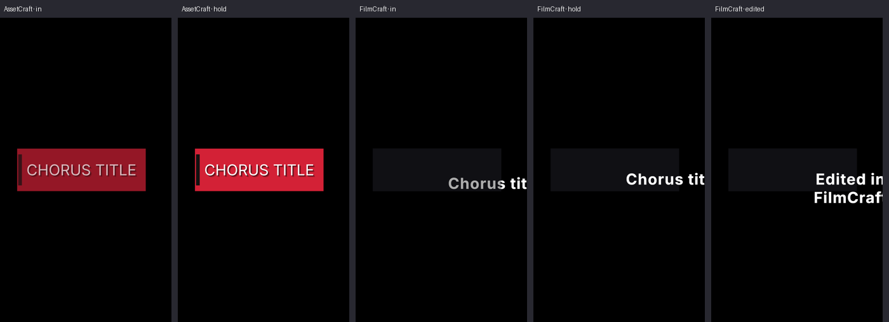

# FilmCraft graphic clips: can an AssetCraft title arrive editable?

_2026-11-25 · D-SF8 spike · done; feeds the Send-to-FilmCraft decision_

- **Scope:** whether an AssetCraft in-app title (a theme's words on a plate, in an area, with
  its in) can be handed to FilmCraft as a native graphic clip instead of a rendered `.mp4`.
- **Project goal it serves:** Send to FilmCraft without baking titles to video files (Paul,
  2026-11-25: rendered `.mp4`s waste disk and make moving a project harder; FilmCraft's and
  EffectCraft's effect controls aren't shared).
- **Immediate area of improvement:** turn a theme's look into graphic layers exactly (GC-2) and
  pick the hand-off route (GC-4).

## How it was checked

[`spikes/filmcraft_graphic_clip_spike.rs`](spikes/filmcraft_graphic_clip_spike.rs) ran as a
throwaway test in a local clone of storytold/filmcraft `960a661` (nothing added upstream). Using
only FilmCraft's own commands, it did these steps:

- made a 1080 × 1920, 24 fps sequence;
- built one graphic clip with a rectangle plate (the AssetCraft area, 810 × 268.8 at the safe
  area's middle) and a bold, centred paragraph text layer;
- keyed the words' opacity and position for a 0.5 s rise-in;
- saved the project as `.fcproj` and opened it in a fresh session;
- listed the layers and exported frames;
- changed the words.

## Findings

| ID   | Finding                                                                                                                                                                                                                                                                                                       | Evidence                                                               | Fix / next step                                                                                                                                                                                      | Owner           | Status    |
|------|---------------------------------------------------------------------------------------------------------------------------------------------------------------------------------------------------------------------------------------------------------------------------------------------------------------|------------------------------------------------------------------------|------------------------------------------------------------------------------------------------------------------------------------------------------------------------------------------------------|-----------------|-----------|
| GC-1 | **It works.** A graphic clip with a plate and words, keyframed, survives save → open (`schemaVersion` 17, 7.7 KB project, no media files) and is editable after (`graphics.setText`)                                                                                                                          | the spike's log and frames above; `crates/project/src/graphic.rs:1-12` | Use FilmCraft graphic clips for in-app titles (option B)                                                                                                                                             | —               | confirmed |
| GC-2 | **The mapping needs care:** a text layer's position is its box's top-left (`localBounds [0,0,730,116]`), so the words sat off the plate; the spike also guessed the theme's colours (AssetCraft's Bold: red plate, caps, accent bar, shadow)                                                                  | frames 3–5 above                                                       | Map each theme's look to layers exactly: text anchored by its box, `caps`, `shadow_*`, `background_*`, accent bar as a second rectangle; compare frames to AssetCraft's own with SF1b-1d's `compare` | Claude          | open      |
| GC-3 | **OTIO can't carry graphic clips**, so this route needs FilmCraft's project file or its commands                                                                                                                                                                                                              | `crates/interchange/src/lib.rs:593`                                    | —                                                                                                                                                                                                    | —               | confirmed |
| GC-4 | **Two hand-off routes:** write the `.fcproj` with `filmcraft-project` / `filmcraft-format` (offline, no FilmCraft running), or drive FilmCraft's commands (`graphics.newShape`, `graphics.newText`, `graphics.set`, `file.saveAs`) as the spike did (the suite's command rule; needs FilmCraft or its engine) | the spike                                                              | Paul's call                                                                                                                                                                                          | Paul            | open      |
| GC-5 | **Build cost:** `filmcraft-engine` took 12 min and ~720 MB of target to build here                                                                                                                                                                                                                            | the spike                                                              | Prefer the `.fcproj` writer (project crates only) if AssetCraft links FilmCraft code                                                                                                                 | Claude          | noted     |
| GC-6 | **EffectCraft designs** (Stack, Laser Trace, pack designs) have no FilmCraft graphic equivalent                                                                                                                                                                                                               | D-SF8 notes                                                            | Keep rendering those (SF1b-1), into the FilmCraft project's media, until FilmCraft can draw EffectCraft designs (upstream)                                                                           | Paul / upstream | open      |
